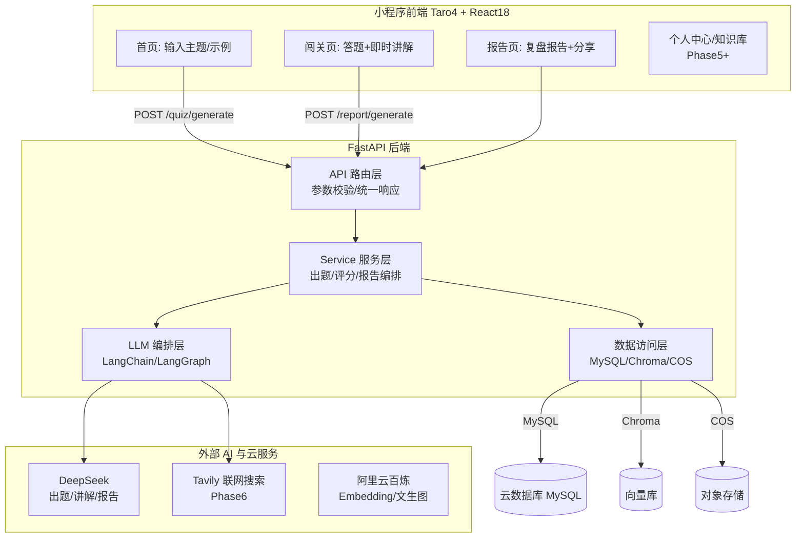

# 《AI 知识闯关学习产品（K12）》方案设计文档

| 项目 | 内容 |
| --- | --- |
| 文档版本 | V1.0 |
| 日期 | 2026-08-20 |
| 需求依据 | 《AI 知识闯关学习产品 需求分析文档》V1.2 |
| 技术选型基准 | 鱼皮《AI 闯关学习小程序》yu-ai-learn（github.com/liyupi/yu-ai-learn），前后端框架以该项目选型为准 |
| 文档性质 | 方案设计（技术选型 + 架构 + 开发流程思路 + 实施计划） |

---

## 1. 文档目标与已确认决策

本文档用于指导「AI 知识闯关学习产品（K12）」从 0 到 1 的 MVP 方案设计与分步实施，重点解决四个问题：

1. **小程序前端技术选型**：小程序生态迭代极快，给出原生 / Taro / uni-app / uni-app x 的最新对比与可执行结论；
2. **整体架构设计**：围绕核心业务闭环「用户输入内容 → AI 生成题目 → 用户答题 → AI 生成分析报告」设计前后端架构；
3. **后端与 AI 方案**：FastAPI 分层架构、DeepSeek 接入、LangChain/LangGraph 编排、核心 Prompt 与数据协议；
4. **分步开发计划**：严格按「先跑通核心闭环、后补登录与数据库」的顺序推进，每一步都有可验收标准。

### 1.1 已确认的决策（与用户对齐）

| 决策点 | 结论 | 依据 |
| --- | --- | --- |
| 产品形态 | 微信小程序 | 需求文档定位 + 参考项目形态（碎片化学习场景，微信生态免安装、易分享） |
| 前端框架 | **Taro 4 + React 18 + TypeScript + Sass** | 以 yu-ai-learn 选型为准（实际锁版本 4.1.11） |
| 后端框架 | **Python 3.11 + FastAPI + Pydantic v2** | 以 yu-ai-learn 选型为准 |
| AI 编排 | LangChain + LangGraph（`langchain-openai` 适配） | 以 yu-ai-learn 选型为准 |
| 大模型 | **DeepSeek（`deepseek-chat` 为主，`deepseek-reasoner` 预留）** | 用户确认 |
| 数据存储 | MySQL（aiomysql 异步连接池）、Chroma 向量库、腾讯云 COS | 以 yu-ai-learn 选型为准 |
| 鉴权 | 微信 `jscode2session` 静默登录 + JWT，**核心流程「可选登录」** | 以 yu-ai-learn 选型为准 |
| 部署 | Docker 容器 + 微信云托管 | 以 yu-ai-learn 选型为准 |
| 开发顺序 | **先核心闭环（无登录、无数据库），后补用户系统与持久化** | 用户明确要求 |
| 目标用户 | K12 中小学学生（6–18 岁），讲解口语化、内容安全第一 | 需求文档 V1.2 |

### 1.2 设计原则

1. **先验证 AI 出题质量，再做外围系统**：题目结构化输出的稳定性是本产品成败的第一变量；
2. **先纯文本链路，再多源输入**：先跑通「一句话/一段文本 → 出题」，再做联网搜索、文档上传、RAG；
3. **先无状态接口，再用户中心**：核心闭环不依赖登录与数据库，跑通后再补 MySQL 与微信登录；
4. **单人独立开发、尽快上线验证**为第一约束，所有选型倾向「生态成熟、教程齐全、排障成本低」；
5. K12 场景把「内容准确性、年龄适宜性、讲解可懂性」放在功能丰富度之前。

---

## 2. 需求收敛与 MVP 边界

### 2.1 产品本质

不是一个传统题库系统，而是一个**把任意输入知识快速转成闯关问答的 AI 学习工具**。用户价值来自三件事：降低学习材料处理门槛、用闯关+即时讲解增强参与感、用复盘报告形成学习闭环。

### 2.2 MVP 保留的核心能力（P0）

| 编号 | 功能 | 对应需求 | 首版实现策略 |
| --- | --- | --- | --- |
| F1 | 多形态知识输入 | 需求第 1 点 | 首版只做**文本输入**（一句话/一段话）；文档、网页、视频解析后置 |
| F2 | 知识自动获取与理解 | 需求第 2 点 | 首版靠 DeepSeek 自身知识 + 输入文本；**Tavily 联网搜索**与 RAG 后置 |
| F3 | 交互式闯关题目生成 | 需求第 3 点 | 单选/多选/判断三题型，3–10 题可配，结构化 JSON 输出 |
| F4 | 即时答题反馈与知识讲解 | 需求第 4 点 | 前端本地即时判题，答完立刻高亮对错 + 展示讲解（答错也有讲解） |
| F5 | 通关知识总结与复盘报告 | 需求第 5 点 | 正确率、掌握/薄弱知识点、三句总结、学习建议、分享金句 |
| F6 | 个人学习数据后台与报告 | 需求第 6 点 | 后置：需 MySQL + 登录，放在核心闭环跑通之后 |
| F7 | 首页示例引导 | 需求补充 | 首版即可做（纯静态数据，无后端依赖），K12 友好主题 |

### 2.3 明确不前置的能力（按阶段后置）

1. 微信授权登录、账号体系、MySQL 持久化 → **Phase 5**（闭环跑通后）；
2. 联网搜索（Tavily）、文档解析、RAG 知识库 → **Phase 6/7**；
3. AI 生图配图 + COS → **Phase 8**；
4. 分享海报生成 → **Phase 9**；
5. 多人对战、排行榜、数字人、语音读题、VIP → 本版本不做（对应需求文档 4.2 扩展功能，仅记录方向）。

---

## 3. 小程序前端技术选型（重点章节）

> 小程序开发更新迭代非常快，选型不能只看理论能力，要看**最新生态状态 + 是否适合单人快速交付 + 后续扩展空间**。本章基于 2026 年 8 月的最新调研给出结论。

### 3.1 候选方案

1. 微信原生小程序（WXML/WXSS/JS/TS）
2. Taro 4.x（React/Vue）
3. uni-app（Vue3）
4. uni-app x（uts + uvue）

### 3.2 对比维度

学习与开发成本、微信小程序适配程度、多端扩展能力、生态成熟度、组件与插件可用性、性能与调试体验、对单人独立开发的友好度、对本项目 MVP 的适配程度。

### 3.3 详细对比表

| 方案 | 技术栈 | 优势 | 劣势 | 适合场景 | 对本项目结论 |
| --- | --- | --- | --- | --- | --- |
| 微信原生 | WXML/WXSS/TS | 官方能力最完整、兼容性最好、微信新特性（Skyline/glass-easel 等）最先落地、问题定位最贴近平台 | 多端扩展差，工程化与组件生态分散，后续迁移 H5/App 成本高 | 只做微信单端、强依赖平台原生能力 | 备选；除非确定永远只做微信单端 |
| **Taro 4.x** | React 18 + TS + Taro API | 开源工程化成熟、VSCode 友好、多端统一（微信/H5/RN）、现代前端工具链、官方持续高频发版（2026 年 4.2.1 已发布） | 仍需理解小程序运行约束与跨端差异 | 独立开发者用现代前端工具链开发微信小程序，保留 H5/RN 扩展空间 | **本项目采用**（与 yu-ai-learn 一致） |
| uni-app | Vue3 + uni API | 中文生态友好、插件市场丰富、Vue3 开发效率高 | 偏 DCloud 工具链，CLI 工程一致性不如 Taro | 接受 DCloud 生态、优先快速上手 | 第二备选 |
| uni-app x | uts + uvue | 2026 年主推「蒸汽模式」：开发态 Web、运行时编译为原生（UTS/JS → 原生，跳过 WebView），性能上限高 | 心智模型重（uts/uvue 约束）、工具链强依赖 HBuilderX、生态兼容边界多 | 高性能原生 App、愿意承担额外工程成本 | 不适合 MVP 首发 |

### 3.4 2026 年生态最新动态（调研要点）

1. **Taro 4.2.1 已发布**：BAT 小程序、H5、RN 端统一框架路线持续演进，仍是国内开源跨端框架中最稳妥的主流选择之一；参考项目 yu-ai-learn 锁定的 4.1.11 属于同代稳定版本，**按 4.x 大版本开发即可，版本可安全升级**。
2. **uni-app x「蒸汽模式」**：2025 年 HBuilderX 4.64 起主推开发态 Web、运行时编译原生的路线，性能前景好，但工程心智成本高，适合性能瓶颈型产品，本项目不是。
3. **微信渲染层演进**：官方新一代组件框架 **glass-easel 已正式开放**，Skyline 渲染引擎持续成熟（WebView → Skyline 有官方迁移指南）。对本项目：**MVP 默认走 WebView 渲染**即可，卡片式答题页对性能不敏感；Taro 对 Skyline 的支持度逐步增强，后续如需更流畅的动画/滚动体验再评估迁移。
4. **微信 AI 扶持政策**：微信向 AI 小程序开放模型能力、送开发者免费 Token 额度（与混元/云开发 AI+ 绑定）。本项目模型选 DeepSeek 由用户确认，但**部署仍可走微信云托管**享受免运维；微信生态的 AI 类目与审核要求（见第 11 章）必须遵守。
5. **类型定义持续更新**：`miniprogram-api-typings` 已发布 5.2.1（2026-05），基础库能力仍在快速迭代，选 Taro 这类有专职团队的框架可平滑吸收平台更新。

### 3.5 最终结论：Taro 4.x + React 18 + TypeScript + Sass

与用户确认的 yu-ai-learn 选型一致，独立理由如下：

1. 最符合「单人独立开发、最短时间交付」约束，`VSCode + CLI + 微信开发者工具` 工作流成熟；
2. 开源、可自由定制，不绑定任何商业工具链；
3. 微信小程序支持成熟，**后续要出 H5 版（家长在浏览器看报告）或 RN 时，代码复用路径清晰**；
4. 贴近现代前端工程体系，便于 ESLint/Prettier/单测/CI 接入；
5. 本项目瓶颈在 AI 闭环质量而非渲染性能，Taro 完全够用；
6. 参考项目 yu-ai-learn 全套页面、组件、构建配置可直接对照学习，排障成本最低。

**锁定版本**（与 yu-ai-learn 实际依赖一致）：`@tarojs/* 4.1.11`、React 18、TypeScript 5.1+、Sass、Webpack 5。

### 3.6 备选与切换成本

- 若后续明确只做微信单端且需要深度原生能力（如最新 Skyline 特效），再评估原生重写；因前后端通过 HTTP API 解耦，前端框架切换不影响后端。
- 若团队偏好 Vue，Taro 同样支持 Vue3，后端与数据协议零改动。

---

## 4. 后端与 AI 技术选型

以下选型全部与 yu-ai-learn 对齐（已按用户确认），本节说明「为什么这么选」及使用边界。

### 4.1 Web 框架：FastAPI

- **为什么**：Pydantic v2 参数校验 + 自动 OpenAPI 文档（`/docs` 即接口文档，前后端并行联调不互相等待）；原生 async/await，适合长耗时的 LLM 调用（出题 10–30 秒）与后续异步任务；个人开发效率极高。
- **配套**：Python 3.11+、Uvicorn、pydantic-settings（配置）、structlog（结构化日志）、pytest + pytest-asyncio（测试）。

### 4.2 AI 编排：LangChain + LangGraph

- **为什么用 LangChain**：`ChatPromptTemplate` 组织系统/用户消息比拼接字符串稳定；`langchain-openai` 的 `ChatOpenAI` 通过 `base_url` 直连 DeepSeek 的 OpenAI 兼容接口；`with_structured_output()` 可把输出约束到 Pydantic Schema，直接得到题库/报告对象。
- **为什么留 LangGraph**：后续联网搜索出题需要「模型自己决定搜什么、搜几轮」的 ReAct Agent（参考项目已实现），LangGraph 是标准答案；MVP 阶段不引入，Phase 6 再上。
- **使用边界**：MVP 只用 `ChatPromptTemplate` + `ChatOpenAI` + 结构化输出；**不**在首版引入 Agent/工具调用/重 RAG 编排。

### 4.3 大模型：DeepSeek

| 项目 | 结论 |
| --- | --- |
| 主力模型 | `deepseek-chat`（出题、报告均用它） |
| 预留模型 | `deepseek-reasoner`（后续复杂推理/难题生成增强，非 MVP 必需） |
| 接入方式 | `ChatOpenAI(base_url=https://api.deepseek.com, model=deepseek-chat)` |
| 出题参数 | temperature 0.4、top_p 0.9、超时 30s、max_tokens 按题量保守设置（防 JSON 截断） |
| 报告参数 | temperature 0.5、top_p 0.9、超时 30s |
| 成本优势 | 中文能力与性价比俱佳，K12 讲解场景输出量大，低价模型是高频出题+讲解的可行性前提 |

**JSON 输出策略（五级保障）**：
1. Prompt 明确要求「只输出合法 JSON，无 markdown/注释」；
2. 代码层兼容 ` ```json ... ``` ` 包裹（正则提取后再解析，参考项目已实现）；
3. Pydantic Schema 校验（`QuizOutput.model_validate`）；
4. 字段完整性校验（题数、选项数、答案格式、题型枚举）；
5. 失败自动重试 1–2 次，仍失败返回友好错误「题库生成失败，请重试」，**绝不让脏数据到前端**。

### 4.4 数据存储

| 组件 | 用途 | 说明 |
| --- | --- | --- |
| MySQL 8.0 | 用户、闯关记录、答题记录、报告、任务、知识库文档、生图日志（7 张表） | `aiomysql` 异步连接池；**Phase 5 才引入**，Phase 0–4 核心闭环不依赖 |
| Chroma（chromadb ≥1.0） | RAG 知识库向量检索 | Phase 7 引入，本地持久化目录运行 |
| 腾讯云 COS | AI 生成题图的永久存储 | Phase 8 引入（大模型临时图片 URL 会过期，必须转存 COS） |

### 4.5 鉴权：微信静默登录 + JWT

- `wx.login` 拿 code → 后端 `jscode2session` 换 openid → 查/建用户 → 签发 JWT（HS256，PyJWT）；
- **「可选登录」设计**：`get_optional_user` 依赖（无 token 不报错，返回 None），出题、答题、报告接口全部兼容未登录态——**未登录也能完整体验核心流程**，这正好支撑「先核心闭环、后登录」的开发顺序；
- 必选登录仅用于：知识库（RAG）、历史记录、个人中心。

### 4.6 联网搜索：Tavily

- 大模型知识有截止日期，出题接入 Tavily 联网搜索保证题目不过时；用 LangGraph 构建 ReAct Agent，模型自主决定搜索关键词与轮数（Phase 6）。
- Tavily 提供免费额度，MVP 成本友好；`ENABLE_WEB_SEARCH` 开关控制，无 Key 时自动降级为纯模型出题。

### 4.7 阿里云百炼（DashScope）

- **Embedding**（`text-embedding-v4`）：RAG 知识库向量化（Phase 7）；
- **文生图**（`qwen-image-2.0`）：题目配图（Phase 8），带每日额度（20 张/日）与并发控制（5）管成本。
- 两者均为可选能力，缺 Key 不影响核心闭环。

### 4.8 技术选型总表（与 yu-ai-learn 对齐）

| 层面 | 技术选型 |
| --- | --- |
| 小程序前端 | Taro 4.1.11 · React 18 · TypeScript · Sass |
| 后端服务 | Python 3.11+ · FastAPI · Pydantic v2 · Uvicorn · asyncio |
| AI 编排 | LangChain · LangGraph · langchain-openai |
| 大模型/检索 | DeepSeek（出题/报告）· 阿里云百炼（Embedding/文生图）· Tavily（联网搜索） |
| 向量检索 | Chroma（RAG 知识库） |
| 数据存储 | MySQL（aiomysql 异步连接池）· 腾讯云 COS |
| 鉴权 | 微信 jscode2session 静默登录 + JWT |
| 测试 | pytest · pytest-asyncio |
| 部署 | Docker · 微信云托管 · 云数据库 MySQL |

---

## 5. 整体系统架构设计

### 5.1 架构目标

1. 前后端可并行开发（HTTP API + OpenAPI 文档解耦）；
2. AI 生成结果必须结构化，前端不依赖脆弱的文本解析；
3. 后续扩展输入源（搜索/文档/RAG）、用户系统时不推翻核心模块。

### 5.2 总体架构图



### 5.3 后端分层职责（与参考项目一致）

| 层 | 目录 | 职责 |
| --- | --- | --- |
| API 层 | `app/api/v1/routes/` | 参数校验、统一响应/错误码、接口日志、鉴权依赖注入 |
| Service 层 | `app/services/` | 编排出题/评分/报告/搜索/RAG 流程，JSON 兜底校验，组装业务对象 |
| LLM 层 | `app/llm/` | 模型工厂（温度/超时/重试）、出题链、报告链、结构化 Schema |
| Prompt 层 | `app/prompts/` | 版本化 Prompt 模板（出题/报告/RAG/搜索） |
| 模型层 | `app/models/` | Pydantic 领域模型（题目、报告、用户、知识库） |
| 仓储层 | `app/repositories/` | MySQL/任务/知识库/生图日志的数据访问 |
| 基础设施层 | `app/core/` | 配置、数据库连接池、鉴权、异常、安全过滤 |

### 5.4 三大核心数据流

#### 流程一：生成题目

```
用户输入(首页) → 前端请求 → [后端] 敏感词/长度校验 → 获取参考资料
  ├─ Phase6+：Tavily 联网搜索（LangGraph ReAct Agent）
  └─ Phase7+：指定文档时走 Chroma RAG
→ LangChain 出题链调用 DeepSeek（结构化 JSON） → Pydantic 校验(失败重试)
→ 返回 {quiz_id, title, summary, questions[]} → 前端跳转闯关页
（Phase5+：已登录则异步落库 quiz_sessions，落库失败不影响返回）
```

#### 流程二：用户答题（本地即时判题）

```
闯关页展示题目 → 用户选择答案 → 前端本地与 answer 比对
→ 即时高亮正确答案/标记错误 + 展开讲解（答错也有讲解）
→ 记录 {question_id, selected_answers, is_correct, duration_ms}
→ 全部完成 → 一次性提交答题记录换取报告
```

> **不设计「单题提交判题接口」**：正确答案已在题库 JSON 中，前端即时反馈零延迟、省接口复杂度；核心目标是验证题目/报告质量，不是实时对战。单题提交只在将来做「防作弊」时才需要。

#### 流程三：生成报告

```
后端接收 {quiz_id, topic, questions[], answer_records[]}
→ 本地统计：正确率、每题用时、知识点对错分布
→ 报告链调用 DeepSeek → 结构化报告 JSON
→ 前端渲染：掌握度评分、薄弱知识点、三句总结、学习建议、分享金句
```

---

## 6. 核心数据模型与 API 协议

### 6.1 领域模型（与参考项目完全一致，Pydantic 定义）

```jsonc
// 题库 QuizOutput
{
  "quiz_id": "quiz_xxxxxxxxxxxx",   // quiz_ + 12位hex
  "title": "学习主题",
  "summary": "本次题库的主题摘要",
  "questions": [
    {
      "id": "q1",
      "type": "single",              // single | multiple | judge
      "stem": "题干",
      "options": [{"key": "A", "text": "选项A"}, {"key": "B", "text": "选项B"}, ...],
      "answer": ["A"],               // 正确答案 key 列表
      "explanation": "详细讲解（口语化、适合中小学生）",
      "knowledge_point": "知识点标签",
      "difficulty": "easy",          // easy | medium | hard
      "image_url": null              // Phase8：AI 配图 URL，可空
    }
  ]
}

// 答题记录 AnswerRecord
{ "question_id": "q1", "selected_answers": ["A"], "is_correct": true, "duration_ms": 3200 }

// 报告 ReportOutput
{
  "accuracy": 80,
  "mastered_points": ["掌握较好的知识点"],
  "weak_points": ["薄弱知识点"],
  "three_line_summary": ["一句话总结1", "一句话总结2", "一句话总结3"],
  "advice": ["复习建议1", "复习建议2"],
  "share_quote": "一句可用于分享的学习金句"
}
```

### 6.2 接口清单（含各阶段引入时机）

| 接口 | 方法 | 说明 | 引入阶段 |
| --- | --- | --- | --- |
| `/api/v1/health` | GET | 健康检查 | Phase 0 |
| `/api/v1/quiz/generate` | POST | 生成题库（同步，直接返回） | Phase 1 |
| `/api/v1/quiz/generate/async` | POST | 异步出题，立即返回 task_id | Phase 1（长耗时场景） |
| `/api/v1/quiz/task/{task_id}` | GET | 轮询任务状态（pending/running/completed/failed） | Phase 1 |
| `/api/v1/report/generate` | POST | 生成复盘报告 | Phase 3 |
| `/api/v1/user/login` | POST | code 换 openid + JWT | Phase 5 |
| `/api/v1/user/history` 等 | GET | 历史闯关列表/报告回看 | Phase 5 |
| `/api/v1/knowledge/*` | POST/GET | 知识库文档上传/解析/向量化/出题 | Phase 7 |

### 6.3 统一响应规范

```jsonc
// 成功
{ "code": 0, "message": "ok", "data": { ... } }
// 失败
{ "code": 4001, "message": "题库生成失败，请稍后重试", "data": null }
```

错误码分段：400x 业务错误（含内容安全拦截）、401x 鉴权错误、500x 服务端异常。所有 LLM 异常都转换为用户可懂的文案，不把堆栈暴露给前端。

### 6.4 异步任务模式（出题慢时的体验兜底）

出题链涉及联网搜索时耗时可达 10–30 秒，微信小程序请求超时风险高。方案：
1. 前端优先走异步接口 → 立即拿 task_id；
2. 前端轮询 `quiz/task/{id}`（1–2 秒间隔，最多约 60 秒）；
3. 后端 `asyncio.create_task` 后台执行，状态机 pending → running → completed/failed 落 `quiz_tasks` 表（内存版可用字典，Phase 5 落库）；
4. 同步接口保留，用于纯文本快速出题与调试。

---

## 7. 核心 Prompt 设计（K12 适配重点）

Prompt 质量直接决定 MVP 体验，首版优先追求「稳定、结构化、可解析」，并针对 K12 做专项约束。

### 7.1 出题 Prompt（在参考项目 V1 基础上增加 K12 约束）

```text
【系统】你是一名专业的中小学 AI 学习教练。你只能输出合法 JSON，不要输出任何 JSON 之外的内容，
包括 markdown、注释、说明文字。当提供了参考资料时，必须优先基于参考资料出题，确保知识的准确性。

【用户】
请根据学生提供的学习内容，生成一组用于小程序闯关答题的题目。
要求：
1. 输出必须是合法 JSON。
2. 题目总数为 {question_count} 题（3~10）。
3. 题型：单选(single)、多选(multiple)、判断(judge)，比例约 3:1:1；判断题选项固定为 A 正确、B 错误；多选题正确答案至少 2 个。
4. 每道题包含：id、type、stem、options、answer、explanation、knowledge_point、difficulty。
5. 题目与讲解必须适合中小学生（6~18 岁）：用词口语化、贴近生活，避免过度学术化；
   涉及专业术语时必须先用一句话通俗解释。
6. 内容必须积极健康、准确无误，不得包含暴力、色情、政治敏感或任何不适合未成年人的内容。
7. 如果输入内容过短，可以基于常识合理补充，但不要偏离主题。
8. 难度要求：{difficulty}（easy|medium|hard|mixed）。
9. 每道题的 explanation 必须包含两部分：①本题正确答案及原因；②1~2 句拓展知识点。
10. 输出 JSON 结构如下（严格按此结构）：
{ ...QuizOutput 结构示例... }
{search_context_section}
学生想学的内容如下：
{user_input}
```

### 7.2 讲解质量要求（差异化核心）

- 讲解是「学完有收获」的核心体验，也是本项目与纯刷题产品的差异点；
- 结构：**正确答案 → 为什么对 → 易错点辨析 → 1 句记忆口诀/生活化类比**（可选）；
- 语言：像耐心的老师，不用「综上所述、值得注意的是」等书面腔。

### 7.3 报告 Prompt（参考项目 V1 + K12 鼓励式调性）

```text
【系统】你是一名中小学学习复盘教练。你只能输出合法 JSON。
【用户】请根据学生本次闯关答题记录生成结构化复盘报告。
要求：
1. 只输出合法 JSON。
2. 语言清晰、鼓励式，但不要空泛；面向中小学生，建议要具体可执行（如"把错题再闯一遍"）。
3. 分析基于真实答题情况，不编造未出现的结论。
4. 适合移动端阅读，简洁有力。
5. share_quote 简短有感染力，适合分享给同学/家长。
JSON 结构：{ accuracy, mastered_points[], weak_points[], three_line_summary[], advice[], share_quote }

学生主题：{topic}
题库数据：{quiz_json}
答题记录：{answer_records}
统计结果：{score_summary}
```

### 7.4 Prompt 版本管理

- 文件名即版本：`quiz_prompt_v1 / v2`、`report_prompt_v1`；
- 改 Prompt 必须跑「Prompt 契约测试」（固定输入断言输出 Schema 字段完整），防止模型输出回归；
- 为后续 A/B 与难度分龄（小学/初中/高中）预留扩展点。

---

## 8. 前端设计

### 8.1 页面与目录结构（与参考项目一致）

```
frontend/src/
  pages/
    index/      首页：主题输入 + K12 示例主题卡片
    quiz/       闯关页：答题、即时判题、讲解
    report/     报告页：复盘报告 + 分享
    profile/    个人中心：经验值、历史闯关（Phase 5 启用）
    knowledge/  知识库：文档上传/RAG 出题（Phase 7 启用）
  services/     请求封装（Taro.request + 统一响应解析）
  assets/       插画、图标等静态资源
```

### 8.2 首页（含 F7 示例引导）

- 极简输入区：一个输入框 + 「开始闯关」按钮，支持输入一句话/一段话；
- **示例主题卡片**（P0，静态数据）：精选适合 K12 问答式学习的主题，如：
  - 「水的三态变化是什么？」（小学科学）
  - 「勾股定理怎么来的？」（初中数学）
  - 「光合作用是怎么发生的？」（初中生物）
  - 「为什么会有四季？」（地理常识）
  - 「英语一般现在时怎么用？」（英语语法）
- 点击示例即自动填入输入框，一键出题，降低「不知道学什么」的启动阻力；
- 出题中展示 loading 与轮询状态（生成中动画 + 进度文案），失败可重试。

### 8.3 闯关页

- 顶部：进度条（第 x/n 题）、正确数、本局经验值；
- 题型渲染：单选（点击即选中）、多选（多选后确认）、判断（A 正确 / B 错误两按钮）；
- **即时反馈**：提交后立刻高亮正确答案、标红错选，底部展开讲解卡片（可折叠，避免页面过长）；
- 答对 +XP、答错也给讲解，讲完「下一题」；全部完成自动进入报告生成。

### 8.4 报告页

- 掌握度评分（大数字 + 鼓励文案）、正确率环图；
- 掌握知识点（绿色标签）/ 薄弱知识点（橙色标签）；
- 三句知识总结卡片、学习建议列表、分享金句；
- 分享按钮（Phase 9 生成海报长图：正确率、主题、金句、小程序码）。

### 8.5 视觉风格设计（需求：接地气、干净简洁、偏动漫、阅读舒适）

- **配色**：明快低饱和主色（如奶油白底 + 天空蓝/草绿主色 + 珊瑚橙点缀），避免刺眼高饱和荧光色；
- **圆角与留白**：卡片式布局、大圆角（16–24rpx）、宽松行距，长文讲解阅读舒适；
- **动漫感**：轻量插画风空状态图（吉祥物「学习伙伴」）、emoji 点缀关卡/成就、答对时轻量动效（缩放+粒子），**不堆砌动画**；
- **字体**：正文加大（≥32rpx），讲解使用高对比深色文字；
- 组件策略：自定义轻量组件为主，MVP 不引入重 UI 框架。

### 8.6 状态管理与请求封装

- MVP 用页面内状态 + 少量轻量全局状态即可，不引入重型状态库；
- `services/` 统一封装：注入后端 baseURL（开发/生产自动切换）、统一解包 `{code, message, data}`、401 引导可选登录、网络异常 toast。

---

## 9. 数据库设计（Phase 5 引入，与参考项目一致）

> 全部表 `MYSQL_AUTO_INIT=true` 时启动自动创建，共 **7 张表**，字符集 utf8mb4。

| 表 | 关键字段 | 说明 |
| --- | --- | --- |
| users | id, openid(唯一), nickname, avatar_url, total_xp | 微信静默登录用户，XP 累计 |
| quiz_sessions | id, quiz_id(唯一), user_id(可空), title, summary, user_input, questions_json | 每次出题的题库快照（JSON 列） |
| answer_records | id, quiz_id(唯一), user_id(可空), records_json, total_questions, correct_count, accuracy | 一轮答题记录 |
| reports | id, quiz_id(唯一), user_id(可空), report_json | 复盘报告快照 |
| quiz_tasks | id, task_id(唯一), user_id, user_input, status, result_json, error_message | 异步出题任务状态 |
| kb_documents | id, user_id, name, type, status, chunk 元信息等 | RAG 知识库文档（Phase 7） |
| image_generation_logs | id, quiz_id, user_id, model, status, cos_url | 生图日志与额度控制（Phase 8） |

设计要点：核心对象（题库/记录/报告）以 JSON 快照列存储，**读写简单、回看历史无需重建**；user_id 全部可空 + 外键 `ON DELETE SET NULL`，天然支持「未登录体验，登录后关联」。

---

## 10. 开发流程与分阶段实施计划（重点章节）

### 10.1 开发思路总纲

```
正确顺序（本方案坚持）：
  ① 后端 AI 出题接口 → ② 前端闯关页 → ③ 报告接口 → ④ 端到端闭环 → ⑤ 登录/数据库 → ⑥ 搜索/文档/RAG → ⑦ 生图 → ⑧ 打磨与上线

一开始绝不做：
  用户系统、MySQL 表、分享海报、多端适配细节
```

理由：本项目的核心不是「题目展示页面」，而是「**AI 能否稳定生成可玩、可讲解、可复盘的结构化题库**」。这一步不稳，后面的账户、数据库都没有价值。参考项目同样采用「可选登录 + 有登录态才落库」的架构，**核心闭环天然无数据库依赖**，与本顺序完全兼容。

### 10.2 里程碑总览

| 里程碑 | 阶段 | 核心产出 | 依赖新增 |
| --- | --- | --- | --- |
| M0 工程就绪 | Phase 0 | 前后端骨架、健康检查 | 无 |
| **M1 核心闭环（MVP）** | Phase 1–4 | 输入 → AI 出题 → 答题讲解 → AI 报告 | **仅 DeepSeek API Key** |
| M2 数据与账号 | Phase 5 | MySQL 7 表、微信登录、历史回看 | MySQL、小程序 AppID |
| M3 知识获取增强 | Phase 6–7 | 联网搜索 Agent、文档上传 RAG | Tavily、百炼 Embedding |
| M4 完整体验 | Phase 8–9 | AI 配图、分享海报、K12 视觉打磨 | 百炼文生图、COS |
| M5 上线 | Phase 10 | 云托管部署、审核发布 | 云托管、域名备案、类目资质 |

### 10.3 Phase 0：环境搭建（0.5–1 天）

- 目标：建立前后端基础工程，接通 DeepSeek API。
- 交付物：
  1. 前端：`taro init`（React + TS + Sass）初始化，配置 `dev:weapp` 脚本；
  2. 后端：FastAPI 工程（`app/main.py` + 分层目录骨架）、requirements.txt（对齐参考项目）；
  3. `.env` 配置（至少 `DEEPSEEK_API_KEY`）、structlog 日志；
  4. `GET /api/v1/health` 健康检查；
  5. 微信开发者工具导入 `frontend/dist`，勾选「不校验合法域名」联调 localhost。
- 验收：`/docs` 可访问；小程序页面能看到后端返回的健康状态。

### 10.4 Phase 1：后端 AI 出题接口（1–2 天，**最优先**）

- 目标：优先验证最核心的 AI 能力——这是全项目第一优先级。
- 交付物：
  1. `POST /api/v1/quiz/generate`（同步）+ `/generate/async` + `/task/{id}`（异步）；
  2. 出题 Prompt V1（含第 7.1 节 K12 约束）；
  3. DeepSeek JSON 提取（兼容 markdown 包裹）+ Pydantic 校验 + 重试兜底（第 4.3 节五级保障）；
  4. 内容安全过滤（敏感词 + 长度 1–2000 校验）。
- 验收：**连续生成 10 次结构稳定，≥80% 输出一次通过 Schema 校验**；用 Swagger/curl 手工体验 3–5 个 K12 主题，题目与讲解质量可接受。

### 10.5 Phase 2：小程序闯关页（1–2 天）

- 目标：完成答题流程与即时讲解交互。
- 交付物：首页输入页（含 F7 示例主题卡片，静态数据）、闯关页、本地判题逻辑、XP/进度条 UI、讲解折叠卡片。
- 开发技巧：**先拿 Phase 1 的真实 JSON 存成静态 mock 文件开发页面**，页面完成后再接真实接口，避免等待出题接口浪费时间。
- 验收：单选/多选/判断正确渲染；答题后立刻高亮对错 + 展示讲解；多题切换顺畅；loading/失败重试态齐全。

### 10.6 Phase 3：报告生成接口（1 天）

- 目标：打通答题结束后的复盘闭环。
- 交付物：`POST /api/v1/report/generate`、报告 Prompt V1、本地统计逻辑（正确率/知识点对错分布）。
- 验收：同一份答题记录，报告能真实反映对错差异；总结与建议不是模板废话（人工抽查 5 组）。

### 10.7 Phase 4：端到端闭环联调（1 天）★ M1 验收

- 目标：打通「输入 → 出题 → 答题 → 报告」完整链路，**全程无登录、无数据库**。
- 交付物：首页接真实出题接口（异步轮询）、闯关页承接真实数据、报告页展示真实 AI 结果、异常态与空态处理。
- **M1 验收（核心 MVP 完成）**：
  1. 在微信开发者工具里，从未登录状态完成「输入一个 K12 主题 → 闯 5 关 → 拿到报告」全流程；
  2. 出题失败可重试、报告生成失败可重试；
  3. 全程无 MySQL、无登录依赖，仅需 DeepSeek Key。

> 到 M1 为止，产品已经可以给真实学生试用收集反馈，再决定后续投入——这是本方案刻意设计的第一个「验证点」。

### 10.8 Phase 5：数据持久化 + 微信登录（2–3 天）

- 目标：从「一次性体验」变成「可积累」。
- 交付物：MySQL 接入（aiomysql 连接池、启动自动建 7 张表）；`POST /api/v1/user/login`（code→openid→JWT）；可选登录依赖改造（出题/报告接口兼容未登录）；闯关记录/报告落库；个人中心（总 XP、历史闯关列表、报告回看）。
- 前置：微信小程序测试号（本地开发即可，无需正式注册）。
- 验收：未登录可完整体验（回归 M1）；登录后闯关出现在历史记录；重启服务历史不丢。

### 10.9 Phase 6：联网搜索增强出题（1–2 天）

- 目标：让题目「不过时」（如「2026 年有哪些新发现」类主题）。
- 交付物：Tavily 工具接入；LangGraph ReAct Agent（模型自主决定搜索关键词与轮数）；搜索上下文注入出题 Prompt；`ENABLE_WEB_SEARCH` 开关降级。
- 验收：输入「最新」类主题，题目包含搜索到的真实信息；无 Key/搜索失败时自动降级纯模型出题，流程不断。

### 10.10 Phase 7：文档输入 + RAG 知识库（2–3 天）

- 目标：支持「基于自己的资料出题」（对应需求 F1/F2 的多形态输入，及需求 4.2 扩展 1）。
- 交付物：文档上传（PDF/Word/Markdown/txt，大小限制 10MB）；解析（pypdf/docx2txt）、分块（1000 字/150 重叠）、百炼 Embedding 向量化入 Chroma；`doc_id` 出题模式（检索 TopK=4 注入出题 Prompt）；知识库页（列表/上传/删除）。
- 验收：上传一份课文 PDF → 出题内容围绕该文档；非文档所属用户不可见（权限隔离）。

### 10.11 Phase 8：AI 配图 + COS（1–2 天）

- 目标：直观学习体验（对应需求 4.2 扩展 2「AI 生图」）。
- 交付物：千问文生图（512×512）按知识点生成题图；转存 COS 得永久 URL 写回 `question.image_url`；每日额度（20 张）+ 并发（5）控制；生图失败绝不影响出题主流程。
- 验收：开启配图后题目显示图片；额度用尽时给出提示且题目正常返回。

### 10.12 Phase 9：体验打磨（2–3 天）

- 目标：达到需求文档「接地气、干净简洁、偏动漫、阅读舒适」的完整体验。
- 交付物：K12 视觉主题落地（第 8.5 节）；报告分享海报（Canvas 绘制：主题/正确率/金句/小程序码，长图保存相册）；XP 结算动效；首页示例主题精选与点击率埋点（可用微信小程序数据分析）。
- 验收：3 名目标年龄学生试用，能独立完成闯关并表示「讲解看得懂」；分享海报可保存分享。

### 10.13 Phase 10：部署上线（2–4 天，含审核等待）

- 目标：真实上线，微信里搜得到。
- 交付物：后端 Dockerfile 构建镜像 → 微信云托管发布；云数据库 MySQL；环境变量注入（各类 Key、JWT_SECRET，绝不进代码库）；request 合法域名白名单配置；正式小程序注册（AppID）、**服务类目申请**（AI 类需「深度合成 - AI 问答」类目及资质材料）、ICP 备案、提交代码审核。
- 验收：正式版小程序审核通过，微信搜索可用；云托管按量计费成本符合第 12 章测算。

### 10.14 单人开发总工期估算

| 里程碑 | 预计工期 |
| --- | --- |
| M0–M1（核心闭环 MVP） | **约 4–6 个工作日** |
| M2–M4（完整功能） | 约 9–13 个工作日 |
| M5（上线） | 约 1–2 周（含备案/审核等待，可并行打磨） |

---

## 11. 内容安全与合规（K12 重点）

K12 是强监管场景，安全投入优先级高于功能：

1. **输入侧过滤**：敏感词库过滤 + 长度限制（1–2000 字），违规即拒绝并提示（参考项目 `check_content` 已在出题入口强制调用）；
2. **输出侧约束**：Prompt 明确禁止不适内容 + 讲解年龄适宜性约束；建议对出题结果做关键词兜底扫描，命中则整卷拒绝重生成；
3. **知识准确性**：联网搜索出题要求「优先基于参考资料」；纯模型出题明确要求不编造；
4. **合规红线**：
   - AI 类小程序需申请「深度合成 - AI 问答」服务类目（需资质材料）；
   - 生成内容页需显著标识「内容由 AI 生成」；
   - 遵守《生成式人工智能服务管理暂行办法》，商用前完成算法备案（以最新监管要求为准）；
   - 未成年人保护：不收集不必要的个人信息；用户输入的学习内容属于个人信息，明确告知与删除机制；建议接入微信内容安全 API 加强审核。
5. **隐私**：静默登录只拿 openid；学习记录仅用于产品功能，可删除。

---

## 12. 成本估算（单人开发，按量计费）

| 项目 | 估算 |
| --- | --- |
| DeepSeek（出题） | 单次约输入 1.5K token + 输出 1.5K token，按官方公开价约 **¥0.01–0.02/次**（以平台最新价为准，deepseek-chat 性价比极高） |
| DeepSeek（报告） | 单次输出约 0.5–1K token，约 ¥0.01 以内/次 |
| 联网搜索 Tavily | 有免费额度（1000 次/月级别），MVP 阶段基本免费 |
| 百炼 Embedding/文生图 | 按量极低；生图限 20 张/日控制 |
| 微信云托管 + 云数据库 MySQL | 最低配约 ¥30–60/月起步，按量伸缩 |
| 腾讯云 COS | 存储+流量按量，MVP 阶段月成本可忽略 |
| **总估计** | 开发期（API 测试）约 ¥10–50/月；上线初期综合 **¥50–100/月** 量级 |

---

## 13. 风险分析与应对

| 风险 | 影响 | 应对 |
| --- | --- | --- |
| LLM 输出 JSON 不稳定 | 核心流程中断 | 五级保障（第 4.3 节）+ 重试 + 友好报错；契约测试防回归 |
| 出题知识不准确/过时 | K12 场景致命 | 联网搜索增强（Phase 6）+ Prompt「不得编造」+ 讲解兜底校验 |
| 内容不适合未成年人 | 合规与口碑风险 | 第 11 章多层过滤 + 输出扫描 + AI 生成标识 |
| 出题耗时过长，体验差 | 流失 | 异步任务 + 轮询 + loading 设计；超时自动失败可重试 |
| 单人维护成本 | 项目失控 | 严格分阶段、每阶段验收；不提前引入 MySQL/RAG 等重依赖 |
| 成本失控 | 亏损 | 按量计费 + 每日额度（生图/搜索）+ 单用户限频 |
| 同质化竞争 | 留存差 | 差异化：K12 讲解质量、复盘价值、动漫风体验、示例降低门槛 |
| 审核/备案受阻 | 无法上线 | 提前准备类目资质、AI 标识与隐私政策；先测试号跑通再申请 |

---

## 14. 测试策略

- **Prompt 契约测试**（重点）：固定输入断言输出字段完整/类型正确（`test_prompt_contract.py`），mock 大模型不消耗 API 额度；
- 单元测试：评分逻辑（`test_scoring.py`）、安全过滤、鉴权、文档解析、向量检索、生图额度；
- 接口测试：quiz/report/user/knowledge 各路由（pytest + httpx）；
- 集成测试：出题×搜索、出题×配图、出题×doc_id 的组合路径（参考项目已提供范例）；
- 手工测试：每次改 Prompt 后跑「10 次连续出题」结构稳定性检查（Phase 1 验收标准）；
- 真机测试：微信开发者工具 + 真机预览，重点测请求超时、弱网、分享链路。

---

## 15. 部署与上线方案

1. **后端**：`backend/Dockerfile` 构建镜像 → 微信云托管（自动负载、免运维）→ 环境变量注入全部密钥（数据库密码、DeepSeek/Tavily/百炼 Key、COS 密钥、微信 AppSecret、JWT_SECRET）；
2. **数据库**：云数据库 MySQL 8.0（同区域低延迟）；
3. **前端**：`npm run build:weapp` 产出 dist → 微信开发者工具上传 → 提交审核；
4. **域名与网络**：云托管默认域名加入小程序 request 合法域名白名单；若自行备案域名则走 ICP 备案；
5. **发布流程**：服务类目申请（深度合成-AI 问答）→ 资质提交 → 体验版真机测试 → 提交代码审核 → 正式发布；
6. **可观测**：structlog 结构化日志 + 云托管日志检索；核心指标：出题成功率、平均耗时、报告生成成功率。

---

## 16. 后续迭代方向（对应需求文档 4.2，本版本不做）

| 扩展 | 说明 | 依赖 |
| --- | --- | --- |
| RAG 知识库 | 已纳入 Phase 7（企业培训/题库备考复用） | 本版本即做 |
| AI 生图 | 已纳入 Phase 8 | 本版本即做 |
| VIP 充值 | 简单会员：每日闯关次数、历史留存、配图额度 | M5 后评估 |
| 多人对战 PK/排行榜 | 需 WebSocket/轮询实时同步，成本高 | 远期 |
| 数字人、语音读题 | 接入 TTS/数字人服务 | 远期 |
| 错题本与复习提醒 | 高价值轻量功能，建议紧随 M2 | 微信订阅消息 |
| 家长端 H5 报告页 | Taro 直接 `build:h5`，复用度高 | 按需 |

---

## 17. 待确认事项清单（请用户 Review）

以下为不影响主线开发的小决策点，可按默认值先行：

| # | 事项 | 当前默认 |
| --- | --- | --- |
| 1 | 产品正式名称与吉祥物形象 | 「AI 闯关学习」暂用名，Phase 9 前定 |
| 2 | 是否照搬参考项目的「经验值 XP」体系，还是换成更适合 K12 的「星星/能量」 | 沿用 XP，文案可改 |
| 3 | 题目数量默认值 | 5 题（可 3–10 调节） |
| 4 | 是否对「小学/初中/高中」分龄出题（难度分档 Prompt） | 首版用 mixed 难度，分龄放后续 |
| 5 | 首页示例主题最终清单 | 第 8.2 节 5 个示例，可增删 |
| 6 | 数据库/部署账号用个人还是企业主体 | 个人主体即可起步，商业化再升级 |
| 7 | 是否需要在 M1 后先内测再继续 M2 | 建议内测（第 10.7 节验证点） |

---

## 附：关键参考

- 需求依据：《AI 知识闯关学习产品 需求分析文档》V1.2（本地 `需求分析文档.txt`）
- 技术选型基准仓库：https://github.com/liyupi/yu-ai-learn （本地参考副本：`reference/yu-ai-learn/`，含完整前后端源码、方案设计文档、保姆级运行指南）
- 2026 小程序生态调研：[Taro 4 多端统一方案](https://aiproducthub.cn/s/14794.html)、[2026 跨端框架横评](https://cloud.tencent.com.cn/developer/article/2685943)、[glass-easel 正式开放](https://www.jzl.com/industry-news/glass-easel)、[WebView→Skyline 迁移指南](https://blog.csdn.net/g9h0i1/article/details/155432385)、[微信 AI 小程序扶持](https://www.163.com/dy/article/L18F2BFS0556I485.html)、[DeepSeek API 价格指南](http://www.nxcode.io/zh/resources/news/deepseek-api-pricing-complete-guide-2026)
